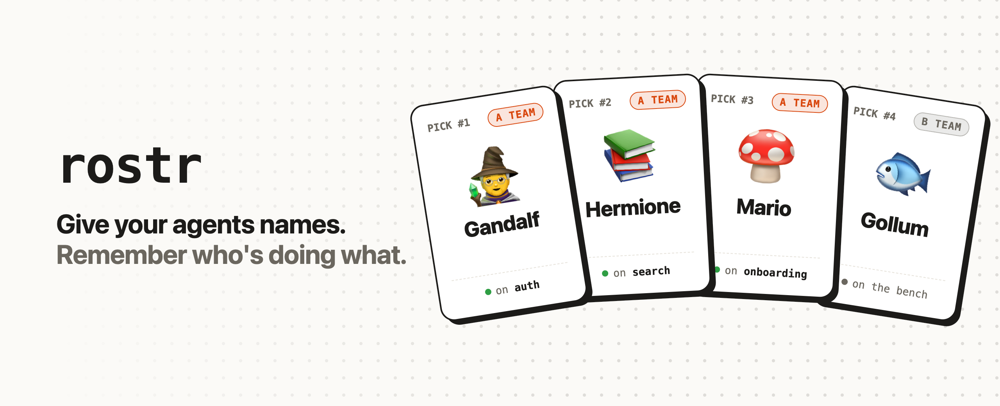

<p align="center">
  <a href="https://getrostr.sh">
    <picture>
      <source media="(prefers-color-scheme: dark)" srcset=".github/assets/banner-dark.png" />
      
    </picture>
  </a>
</p>

<p align="center">
  <a href="https://getrostr.sh">Website</a> ·
  <a href="https://getrostr.sh/cli">CLI docs</a> ·
  <a href="https://getrostr.sh/rosters">Rosters</a> ·
  <a href="https://getrostr.sh/how-it-works">How it works</a>
  <br /><br />
  <a href="https://github.com/piazzatron/rostr/releases/latest"></a>
  <a href="https://github.com/piazzatron/rostr/actions/workflows/ci.yml"></a>
  <a href="LICENSE"></a>
</p>

rostr drafts a name for each of your coding agents from a roster you set and puts it at the front of the session
title: `🧙 Gandalf · Fix auth redirect loop`. It also teaches your agent to reach out as that identity, so when Gandalf
pings you on Slack, GitHub, or email, you know exactly which session needs you.

<p align="center">
  
</p>

## Install

Paste this into your agent:

```text
Set up rostr for me by following the instructions at https://getrostr.sh
```

Or do it yourself:

```sh
brew install piazzatron/tap/rostr   # or: curl -fsSL https://getrostr.sh/install | sh
rostr assemble
```

## Works with

| | Support |
|---|---|
| **Claude Code** | Terminal and cloud |
| **Codex** | Terminal and cloud |
| **tmux** | Names the window and tags the pane (`#{@rostr}`) |
| **herdr** | Shows the name in the sidebar |

Using something else? [Request support](https://github.com/piazzatron/rostr/issues/new?title=Support+for%3A+).

## Commands

Full docs, with examples, at [getrostr.sh/cli](https://getrostr.sh/cli). Run `rostr <command> --help` for every flag.

**Rosters** (you run these)

| Command | What it does |
|---|---|
| `rostr assemble [<roster>]` | Set up a roster: interactive, or with `--preset`, `--names`, `--emoji`, `--cloud`, `--link` |
| `rostr link [<roster>]` | Use a roster for the current project; bare, shows which one it uses |
| `rostr unlink` | Go back to the default roster for the current project |
| `rostr list [<roster>...]` | Who's drafted and what they're working on, and who's idle (`--json` for scripts) |
| `rostr edit [<roster>]` | Edit a roster's members, emoji, and A team in `$EDITOR` |
| `rostr presets` | List the pre-built rosters |
| `rostr disband [<roster>]` | Delete a roster |

**Agents** (your hooks, the skill, and `/draft` run these)

| Command | What it does |
|---|---|
| `rostr draft` | Draft the next free member for this session, A team first |
| `rostr bench [<name>... \| all]` | Send this session's agent, named ones, or all of them back to the bench |
| `rostr task [<name>] <description>` | Set what an agent is working on |

**Settings**

| Command | What it does |
|---|---|
| `rostr config` | Show your settings (`--json` for scripts) |
| `rostr config default <roster>` | Choose the roster projects use when they don't have a link |
| `rostr config emoji on\|off\|only` | Show agents with emoji, without, or as just the emoji |
| `rostr config auto-draft on\|off` | Draft every new session automatically, or only with `/draft` |
| `rostr config expiry <duration>` | How long a draft can go unseen before it's released (`48h`, `7d`, `2w`) |
| `rostr config key` | Print your rostr key |
| `rostr cloud on` | Move your whole setup to the rostr API, or join one with your key |
| `rostr cloud install` | Install the Claude Code hooks in a cloud session's container |
| `rostr uninstall` | Remove rostr from Claude Code and Codex and delete all your rosters |
| `rostr version` | Print rostr's version |

How rostr behaves is specified in [`docs/cli-spec.md`](docs/cli-spec.md).

## Contributing

Bug reports, fixes, and new rosters are welcome. See [CONTRIBUTING.md](CONTRIBUTING.md) for how to build, test, and
submit changes.

## License

[MIT](LICENSE)
