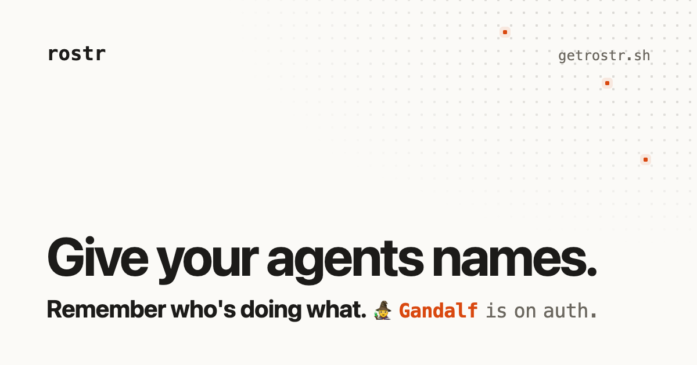

# rostr

[](https://github.com/piazzatron/rostr/actions/workflows/ci.yml)

[](https://getrostr.sh)

**Give your agents names. Remember who's doing what.**

rostr automatically drafts each agent from a roster you set: The Fellowship, Hogwarts, Smash Bros, or your own list.
The name goes at the front of the session title (`🧙 Gandalf · Fix auth redirect loop`), so when five agents are
running you can tell at a glance who's on what. It works across your favorite harnesses and multiplexers, locally and
in the cloud.

It's a small CLI plus a skill that teaches your agent how to use it. More at [getrostr.sh](https://getrostr.sh).

> **Status:** early. The CLI works with Claude Code, locally and in the cloud; Codex support is on the way. The
> [spec](docs/cli-spec.md) is the source of truth for how it behaves.

## Install

The easiest way is to paste this into your agent:

```text
Set up rostr for me by following the instructions at https://getrostr.sh
```

Or do it yourself:

```sh
brew install piazzatron/tap/rostr
rostr assemble   # interactive: pick a roster, emoji, local or cloud, and auto-draft
```

No Homebrew (or on Linux)? `curl -fsSL https://getrostr.sh/install | sh` installs it instead.

Prefer to draft by hand? Turn off auto-draft (`rostr config auto-draft off`) and use `/draft` in Claude Code.

## How it works

1. **Assemble your roster.** Run `rostr assemble`, or ask your agent to do it for you.
2. **Sessions draft agents.** When a session starts, a hook drafts the next available name and gives the agent its
   identity.
3. **Done? Back to the bench.** When a session ends, the agent's identity automatically returns to the bench.

The details, including why the agent writes its own title, are in
[How the session hooks work](https://getrostr.sh/how-it-works).

## Why anthropomorphize?

1. **It exploits your human psychology.** Your brain is built to remember people and what they're doing, not
   "25 independent work streams".
2. **Notifications become easy to triage.** When a notification says 🌱 Samwise, you know what it's about before you
   open it.
3. **Every message gets provenance.** When an agent pings you on Slack, GitHub, or email, it signs its name, so you
   know exactly which session it came from.
4. **Agents can find each other.** "Check with Hermione before you merge."

Also, it's really funny.

## Rosters

Every roster has an **A team** and a **B team**. Twenty names are too many to get to know, so rostr always drafts from
your small A team first (six by default; change it with `rostr edit`) and only calls up the B team when your starters
are busy.

You can have **multiple rosters** and give each project its own with `rostr link`, so a name tells you the project as
well as the task. A project is identified by its git `origin` remote; projects without a roster, and folders outside
git, use your default roster. See all the pre-built rosters at [getrostr.sh/rosters](https://getrostr.sh/rosters).

## Local or cloud

Your whole setup lives in one place:

- **Local** (the default): everything lives on disk. No account, no network.
- **Cloud**: `rostr cloud on` moves everything to the rostr API at `api.getrostr.sh`. From then on, every session, on
  your machine or in a cloud environment like Claude Code on the web or Codex cloud, drafts from there. No account
  needed; having a rostr key is what puts a machine in cloud mode, and agent task and repo metadata are end-to-end
  encrypted. [How the encryption works](https://getrostr.sh/privacy).

## Commands

Full docs at [getrostr.sh/cli](https://getrostr.sh/cli).

**Roster commands** (you run these)

| Command | What it does |
|---|---|
| `rostr assemble` | Interactive setup: pick a roster, emoji, local or cloud, and auto-draft. The only one you need |
| `rostr link <roster>` | Link a roster to the current project (`rostr unlink` to undo) |
| `rostr list` | See who's working on what across your rosters, and who's idle |
| `rostr edit [<roster>]` | Change a roster's members, emoji, or A team |
| `rostr presets` | See all the pre-built rosters |
| `rostr disband <roster>` | Delete a roster |

**Agent commands** (your hooks, the skill, and the `/draft` slash command run these)

| Command | What it does |
|---|---|
| `rostr draft` | Draft the next free agent for a session, A team first |
| `rostr release` | Send an agent back to the bench |
| `rostr task` | Set or change what an agent is working on |

**Settings**

| Command | What it does |
|---|---|
| `rostr config` | See all your settings |
| `rostr config default <roster>` | Choose the roster projects use when they don't have a link |
| `rostr config emoji on\|off\|only` | Show agents with their emoji, without it, or as just the emoji |
| `rostr config auto-draft on\|off` | Draft every new session automatically, or by hand with `/draft` |
| `rostr cloud on` | Move your whole setup to the cloud |
| `rostr config key` | Print your rostr key |

## Repo layout

- `cli/` — the `rostr` CLI and agent hooks
- `site/` — getrostr.sh (Astro), auto-deployed to Vercel
- `server/` — api.getrostr.sh, auto-deployed to Railway
- `docs/` — design docs; [`docs/cli-spec.md`](docs/cli-spec.md) is the source of truth for the CLI
